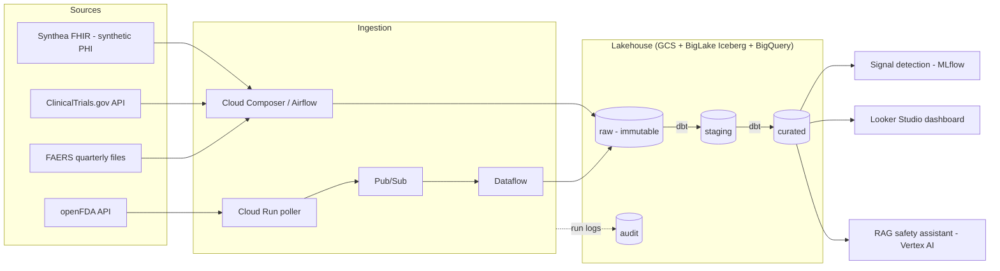

# drug-safety-lakehouse

**A GxP-aligned pharmacovigilance data platform on Google Cloud.**
Ingests FDA adverse event reports (FAERS / openFDA), standardizes them through a governed lakehouse,
and surfaces drug-safety signals, with audit trails, lineage, and PHI controls built in.

> Portfolio project. Uses only public (openFDA, ClinicalTrials.gov) and synthetic (Synthea) data. No real patient data.
>
> In progress. Phase 1 is underway: the openFDA client, CI, and the dev GCP project are in place.
> Streaming, FAERS, PHI masking, and signal detection are designed and not built yet.
> Current status is in [`docs/roadmap.md`](docs/roadmap.md).

---

## Why this project

Every pharmaceutical company runs a pharmacovigilance (drug safety) function, and it is one of the most
regulated data domains in the industry. This project shows how I would design that platform at enterprise grade:

- **Event-driven + batch ingestion** — openFDA API → Pub/Sub → Dataflow, and quarterly FAERS files via Cloud Composer
- **Medallion lakehouse** — raw (immutable) → staging → curated, stored as Apache Iceberg via BigLake
- **Transformations as code** — dbt models with tests, documentation, and lineage
- **Regulated-environment controls** — ALCOA+ data integrity, audit logging, PHI masking, change control, validation docs
- **Healthcare standards** — MedDRA (reactions), RxNorm (drugs), FHIR and OMOP CDM (synthetic patient data)

## Architecture



## Repository layout

| Path | What lives there |
|---|---|
| `src/drug_safe/` | Python package: ingestion clients, audit logging, shared config |
| `pipelines/dataflow/` | Apache Beam streaming pipeline (Pub/Sub → raw) |
| `orchestration/dags/` | Airflow DAGs for batch loads and backfills |
| `dbt/` | dbt project: staging → intermediate → marts, with tests |
| `infra/terraform/` | All GCP infrastructure as code (dev / prod) |
| `docs/adr/` | Architecture Decision Records — *why* things are built the way they are |
| `docs/compliance/` | ALCOA+ control mapping, validation plan, traceability |
| `tests/` | Unit and integration tests |

## Quickstart (Windows + WSL2)

```bash
# 1. Inside WSL2 (Ubuntu)
curl -LsSf https://astral.sh/uv/install.sh | sh
git clone https://github.com/<you>/drug-safety-lakehouse.git && cd drug-safety-lakehouse

# 2. Python environment + hooks
make setup

# 3. Run tests and lint
make test
make lint

# 4. Pull a small sample of adverse events to local disk (no GCP needed)
make sample   # writes to ./data/raw/openfda/...

# 5. Provision GCP (once you have a project + billing alert set)
cp infra/terraform/envs/dev/terraform.tfvars.example infra/terraform/envs/dev/terraform.tfvars
make tf-plan
```

## Roadmap

See [`docs/roadmap.md`](docs/roadmap.md). Status is tracked per phase.

## Key design decisions

- [ADR-0001 — GCP as the primary platform](docs/adr/0001-gcp-primary-platform.md)
- [ADR-0002 — Medallion layers with an immutable raw zone](docs/adr/0002-medallion-immutable-raw.md)
- [ADR-0003 — Report versioning and de-duplication](docs/adr/0003-report-deduplication.md)

## Compliance approach

See [`docs/compliance/alcoa-controls.md`](docs/compliance/alcoa-controls.md) and
[`docs/compliance/validation-plan.md`](docs/compliance/validation-plan.md).

## Data sources and disclaimer

- openFDA drug adverse event API — https://open.fda.gov/apis/drug/event/
- FAERS quarterly data files — FDA
- Synthea synthetic patient generator — https://synthetichealth.github.io/synthea/

openFDA data is not validated for clinical use, and an adverse event report does not establish that a drug caused the event.
This project is for demonstration only.

## License

MIT
